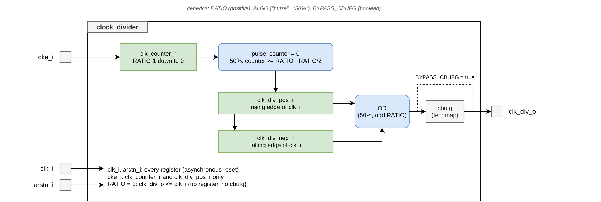
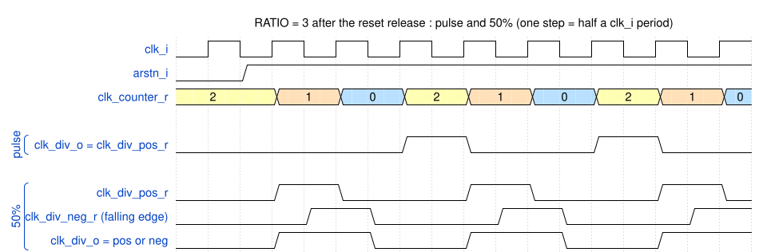

<!--
  README MODEL (common to every Asylum IP, keep the same headings)
  ----------------------------------------------------------------
  Regenerate from the sources, never from the previous README text alone:
    hdl/*.vhd (entities, generics, ports), hdl/csr/*.hjson (register map),
    <IP>.core (VLNV, targets, depends), mk/targets.txt, sim/, syn/, esw/.
  Sections, in this order:
    badges / title + one-line pitch / Overview / Features / Block Diagram /
    Getting Started / Hardware Interfaces / Configuration / Resources /
    Theory of Operation / Registers / Programmer's Guide /
    Design Verification / Dependencies and Related IPs / License
  Rules:
    - English, short and factual: every statement backed by the sources.
    - No VLNV line: the version badge shows it.
    - Badges: first line version, license; second line CI, lint, sim, syn.
    - Block diagram and FSM: pages Overview and FSM of doc/<NAME>.drawio, exported to
      doc/<NAME>-Overview.png and doc/<NAME>-FSM.png (make -C doc).
    - Timing diagrams: WaveDrom source doc/<NAME>-<what>.json, rendered
      doc/<NAME>-<what>.svg (make -C doc), shown as images.
    - No CPU named (OpenBlaze, PicoBlaze, RISC-V) outside the CPU and SoC IPs.
    - Registers: link to the generated hdl/csr/<X>_csr.md, never copy the tables.
    - Tables: Configuration = Name|Type|Default|Description,
      Hardware Interfaces = Name|Direction|Type|Description, grouped by interface.
    - A section with nothing to say is one line ("This IP has no
      software-visible registers."), never removed.
-->
[](https://github.com/deuskane/asylum-component-clock_divider/tags)
[](LICENSE)

[](https://github.com/deuskane/asylum-component-clock_divider/actions/workflows/ci.yml)
[](https://github.com/deuskane/asylum-component-clock_divider/actions/workflows/ci.yml)
[](https://github.com/deuskane/asylum-component-clock_divider/actions/workflows/ci.yml)
[](https://github.com/deuskane/asylum-component-clock_divider/actions/workflows/ci.yml)

# Clock divider

**A small, readable clock divider in VHDL: static ratio, one-cycle pulse or 50 % duty cycle (also for odd ratios), clock enable and technology clock buffer.**

Part of the [Asylum project](https://github.com/deuskane/asylum-project), a collection of small IP cores, written to be read and learned from.

## Table of Contents

1. [Overview](#overview)
2. [Features](#features)
3. [Block Diagram](#block-diagram)
4. [Getting Started](#getting-started)
5. [Hardware Interfaces](#hardware-interfaces)
6. [Configuration](#configuration)
7. [Resources](#resources)
8. [Theory of Operation](#theory-of-operation)
9. [Registers](#registers)
10. [Programmer's Guide](#programmers-guide)
11. [Design Verification](#design-verification)
12. [Dependencies and Related IPs](#dependencies-and-related-ips)
13. [License](#license)

## Overview

This IP divides an input clock by a ratio fixed at elaboration time (`RATIO`). A down-counter clocked on the rising edge of `clk_i` produces either a one-cycle pulse every `RATIO` cycles (`ALGO = "pulse"`) or a clock of period `RATIO` cycles with a 50 % duty cycle (`ALGO = "50%"`); for an odd ratio, a falling-edge register adds the missing half cycle.

The output goes through the clock buffer `cbufg` of `asylum:target:techmap`, so that it can use a global clock resource of the target, unless `BYPASS_CBUFG = true`: the output is then a plain register output, used as a data (for example the `"pulse"` output as a clock enable).

## Features

- Static division ratio `RATIO`; `RATIO = 1` connects `clk_div_o` to `clk_i` (no logic)
- `"pulse"`: `clk_div_o` high during one `clk_i` cycle every `RATIO` cycles
- `"50%"`: period `RATIO` cycles, `RATIO/2` cycles high and low, also for an odd `RATIO` (rising- and falling-edge registers)
- Clock enable `cke_i`: the divider counts enabled `clk_i` cycles and its output freezes when `cke_i = 0`
- Asynchronous reset, active low: `clk_div_o` low during the reset
- Output through the technology clock buffer `cbufg` (pass-through, or the NanoXplore NG-Medium cell), or directly with `BYPASS_CBUFG = true`
- Assertion on an invalid `ALGO` value
- Component declaration in `asylum.clock_divider_pkg`

## Block Diagram



## Getting Started

The cores of the Asylum IPs are published in the FuseSoC library [asylum-cores](https://github.com/deuskane/asylum-cores) (with the UVVM cores used by the testbench):

```bash
pip install fusesoc
fusesoc library add https://github.com/deuskane/asylum-cores
fusesoc run --target sim_duty50_ratio5_period asylum:component:clock_divider  # needs GHDL
```

To use the IP in your design, add `asylum:component:clock_divider` to the `depend` list of your core and instantiate `clock_divider` (library `asylum`):

```vhdl
library asylum;
use     asylum.clock_divider_pkg.all;

  -- Clock divided by 4, 50 % duty cycle, through the clock buffer
  ins_clock_divider : clock_divider
    generic map
    ( RATIO     => 4
     ,ALGO      => "50%"
    )
    port map
    ( clk_i     => clk
     ,cke_i     => '1'
     ,arstn_i   => arst_b
     ,clk_div_o => clk_div4
    );

  -- Clock enable of one cycle every 20 cycles (no clock buffer)
  ins_cke_div20 : clock_divider
    generic map
    ( RATIO        => 20
     ,ALGO         => "pulse"
     ,BYPASS_CBUFG => true
    )
    port map
    ( clk_i        => clk
     ,cke_i        => '1'
     ,arstn_i      => arst_b
     ,clk_div_o    => cke_div20
    );
```

[PWM](https://github.com/deuskane/asylum-component-pwm) uses it as a static prescaler (a `"pulse"` output used as a clock enable), [PicoSoC](https://github.com/deuskane/asylum-soc-picosoc) to derive its internal clock.

## Hardware Interfaces

Top-level entity: **`clock_divider`** ([hdl/clock_divider.vhd](hdl/clock_divider.vhd)), component in `asylum.clock_divider_pkg`.

### Clock and Reset

| Name | Direction | Type | Description |
|------|-----------|------|-------------|
| `clk_i` | in | std_logic | Input clock |
| `cke_i` | in | std_logic | Clock enable, active high: the divider advances only when `1` (ignored when `RATIO = 1`) |
| `arstn_i` | in | std_logic | Asynchronous reset, active low (ignored when `RATIO = 1`) |

### Divided Clock

| Name | Direction | Type | Description |
|------|-----------|------|-------------|
| `clk_div_o` | out | std_logic | Divided clock: through `cbufg` when `RATIO > 1` and `BYPASS_CBUFG = false`, `clk_i` itself when `RATIO = 1` |

## Configuration

Generics of `clock_divider`:

| Name | Type | Default | Description |
|------|------|---------|-------------|
| `RATIO` | positive | `2` | Static division ratio; `1` = no division (`clk_div_o` connected to `clk_i`, `cke_i` and `arstn_i` ignored) |
| `ALGO` | string | `"pulse"` | `"pulse"` (one-cycle pulse) or `"50%"` (50 % duty cycle). Any other value is reported by an assertion (severity failure); a tool that ignores it builds the `"pulse"` divider |
| `BYPASS_CBUFG` | boolean | `false` | `false`: `clk_div_o` through the clock buffer `cbufg` (divided clock); `true`: no clock buffer, `clk_div_o` is used as a data (e.g. the `"pulse"` output as a clock enable) and does not use a clock resource |

The `lint_ghdl*` and `syn_*` targets use [syn/clock_divider_wrapper.vhd](syn/clock_divider_wrapper.vhd), and the testbench its own generics, with a boolean `ALGO_50` (`false`: `"pulse"`, `true`: `"50%"`) instead of `ALGO`: a FuseSoC parameter value cannot contain `%`.

## Resources

Figures of the `syn_*` targets (`make nonreg_syn`, see [Targets](#targets)): [syn/clock_divider_wrapper.vhd](syn/clock_divider_wrapper.vhd) with the generics of each configuration, synthesized by Yosys and its GHDL plugin; the reports are in the build directory of each target (`clock_divider_wrapper_syn.json`).

| Configuration | LUT¹ | LUTRAM¹ | FF¹ | CARRY4¹ | MUXF7/F8¹ | BRAM¹ | DSP¹ | Area² (µm²) | kGE³ |
|---|---|---|---|---|---|---|---|---|---|
| `syn_default` (pulse, RATIO 2) | 2 | 0 | 2 | 0 | 0 | 0 | 0 | 73.82 | 0.020 |
| `syn_pulse_ratio1` (pulse, RATIO 1) | 0 | 0 | 0 | 0 | 0 | 0 | 0 | 0 | 0.000 |
| `syn_pulse_ratio5` (pulse, RATIO 5) | 7 | 0 | 4 | 1 | 0 | 0 | 0 | 165.16 | 0.044 |
| `syn_duty50_ratio4` (50 %, RATIO 4) | 3 | 0 | 3 | 0 | 0 | 0 | 0 | 113.86 | 0.030 |
| `syn_duty50_ratio5` (50 %, RATIO 5) | 8 | 0 | 5 | 1 | 0 | 0 | 0 | 197.69 | 0.053 |

¹ Xilinx Artix-7 (LUT6), Yosys 0.33 `synth_xilinx -flatten -noiopad -noclkbuf`, before place and route: every cell of the netlist is counted, Vivado may differ. Identical cells are merged as a vendor tool does (`opt_merge -share_all`): the inverters of an active-low reset net become one; every remaining cell is counted, an `INV` as a `LUT1`. The IP has no memory (no LUTRAM, no BRAM); `cbufg` is the generic pass-through of `asylum:target:techmap` (no `BUFG` counted).

² SkyWater sky130 `sky130_fd_sc_hd`, typical corner (tt, 25 °C, 1.80 V), Yosys 0.33 `synth` + `dfflibmap` + `abc -liberty`: standard-cell area only, no timing constraint, no buffering, clock tree or placement.

³ Area in thousands of NAND2 gate equivalents (`sky130_fd_sc_hd__nand2_1` = 3.7536 µm²).

With `RATIO` 1 the output is `clk_i` (no logic). With `RATIO` 2 the 2 LUTs are inverters: one on `arstn_i`, shared by both flip-flops, and one for the 1-bit counter, on the `D` input of the counter and of `clk_div_pos_r` (both are `not clk_counter_r`).

## Theory of Operation

### Hierarchy

| File | Unit | Role |
|------|------|------|
| [hdl/clock_divider.vhd](hdl/clock_divider.vhd) | `clock_divider` | Counter, pulse / 50 % generation, falling-edge register, `cbufg` instance (unless `BYPASS_CBUFG`) |
| [hdl/clock_divider_pkg.vhd](hdl/clock_divider_pkg.vhd) | `clock_divider_pkg` | Component declaration of `clock_divider` |

### Counter

`clk_counter_r` counts down from `RATIO-1` to 0 and reloads `RATIO-1`: its period is `RATIO` enabled cycles for both algorithms. The reset loads `RATIO-1` and clears `clk_div_pos_r` and `clk_div_neg_r` (`clk_div_o = 0`).

### "pulse"

`clk_div_pos_r` is `1` during the cycle that follows the counter value 0: output frequency `f_clk / RATIO`, high time one `clk_i` period. The first rising edge of `clk_div_o` comes `RATIO` rising edges of `clk_i` after the reset release.

### "50%"

`clk_div_pos_r` is `1` while the counter is `>= RATIO - RATIO/2`. The first rising edge of `clk_div_o` follows the first rising edge of `clk_i` after the reset release.

- **Even `RATIO`**: `RATIO/2` cycles high and `RATIO/2` low, rising-edge logic only.
- **Odd `RATIO`**: `clk_div_pos_r` is high during `(RATIO-1)/2` cycles; `clk_div_neg_r` copies it on the falling edge of `clk_i`, and `clk_div_o = clk_div_pos_r or clk_div_neg_r` extends the high phase by half a cycle: `RATIO/2` cycles high and low (e.g. 12.5 / 12.5 cycles for `RATIO = 25`). The duty cycle is exactly 50 % when `clk_i` has a 50 % duty cycle; it follows the duty cycle error of `clk_i` otherwise. A rising-edge-only divider would give `(RATIO-1)/2` / `(RATIO+1)/2` cycles.



### Clock enable

When `cke_i = 0`, the counter and `clk_div_pos_r` hold their value and `clk_div_neg_r` copies the frozen `clk_div_pos_r` on the next falling edge: `clk_div_o` is frozen, and the period is counted in enabled `clk_i` cycles. `cke_i` only reaches rising-edge registers (no half-cycle path): `clk_div_neg_r` is always `clk_div_pos_r` delayed by half a `clk_i` cycle. The 50 % duty cycle of an odd `RATIO` is then exact only with `cke_i = 1`: with `cke_i` active one cycle out of `N`, the high time is `((RATIO-1)/2)*N + 1/2` cycles for a period of `RATIO*N` cycles (e.g. 2.5 / 6 cycles for `RATIO = 3`, `N = 2`), whatever the clock edge on which `cke_i` changes.

### RATIO = 1

`clk_div_o <= clk_i`: no register and no `cbufg`, `cke_i` and `arstn_i` have no effect. `clk_div_o` is not frozen when `cke_i = 0` and keeps toggling during the reset. When `RATIO` is computed by the design that instantiates the divider, a design that relies on `cke_i` to stop the divided clock, or on `clk_div_o = 0` during the reset, works with `RATIO = 2` but not with `RATIO = 1`: gate the clock with a clock gating cell (`cgate` of `asylum:target:techmap`) if this is needed, not with a LUT gate.

### Clock buffer and timing

`cbufg` comes from `asylum:target:techmap`: a pass-through (`hdl/generic/cbufg.vhd`) by default, or the NanoXplore NG-Medium cell when the FuseSoC flag `TARGET_NANOXPLORE_NG_MEDIUM` is set. The divided output is a generated clock: declare it as such in the timing constraints of the design. For an odd `RATIO` with `"50%"`, the output combines a rising- and a falling-edge register.

### Invalid ALGO

An assertion (severity failure) reports any value other than `"pulse"` or `"50%"`; the `"pulse"` logic is generated in that case.

## Registers

This IP has no software-visible registers.

## Programmer's Guide

This IP has no software-visible registers: there is nothing to program.

## Design Verification

### Testbench

| File | DUT | Description |
|------|-----|-------------|
| [sim/clock_divider/tb_clock_divider.vhd](sim/clock_divider/tb_clock_divider.vhd) | `clock_divider` | Self-checking UVVM testbench, 10 ns clock, generics `TESTS_LIST` (scenarios, see below), `RATIO` and `ALGO_50` (of the DUT). A second instance with `BYPASS_CBUFG = true` runs next to the DUT: a monitor compares the two `clk_div_o` 1 ns after every change of one of them, in every scenario (`cbufg` is a wire in the generic techmap; these comparisons are not counted below). A process drives `cke_i` (always 1, 0, or 1 one cycle out of 2 changing on the falling or after the rising edges of `clk_i`). Scenarios in `tb_clock_divider_<name>_pkg` ([reset](sim/clock_divider/tb_clock_divider_reset_pkg.vhd), [period](sim/clock_divider/tb_clock_divider_period_pkg.vhd), [cke_stop](sim/clock_divider/tb_clock_divider_cke_stop_pkg.vhd), [cke_half](sim/clock_divider/tb_clock_divider_cke_half_pkg.vhd), [reset_running](sim/clock_divider/tb_clock_divider_reset_running_pkg.vhd), [bypass](sim/clock_divider/tb_clock_divider_bypass_pkg.vhd)), names and dispatch in [tb_clock_divider_tests_pkg](sim/clock_divider/tb_clock_divider_tests_pkg.vhd), helpers (expected times, period and high time measure, timeouts) in [tb_clock_divider_bfm_pkg](sim/clock_divider/tb_clock_divider_bfm_pkg.vhd) |

### Scenarios (`TESTS_LIST`)

The scenarios are chosen at run time with the generic `TESTS_LIST`: names separated by `,` without space (`reset,period,reset`), a name may be repeated. The sequencer first checks every name (an unknown name is a `TB_ERROR` before any scenario runs), then for each scenario drives a reset pulse with `cke_i = 1`, released on a falling edge of `clk_i`, logs `TEST <i>/<N> : <name>` and runs it: each scenario starts from reset. The empty list (default) only compiles and elaborates the testbench. The list is parsed and its names checked with `list_length` / `list_item` / `list_contains` of `asylum.string_pkg` (`asylum:utils:pkg` >= 1.10.0). Every wait on `clk_div_o` has a timeout (200 cycles): a stuck output is an error, not a hang.

Checks counted as the `=> OK` lines of the log, for `RATIO > 1` (both algorithms) and for `RATIO = 1`, where every scenario checks that `clk_div_o` follows `clk_i` whatever `cke_i` and `arstn_i`:

| Name | Checks (`RATIO > 1`) | Checks (`RATIO = 1`) | Description |
|------|--------|--------|-------------|
| `reset` | 5 | 1 | Reset held 10 cycles: `clk_div_o` low and stable; reset released on a falling edge: first rising edge of `clk_div_o` at the expected rising edge of `clk_i` (`RATIO` for pulse, 1 for 50 %), first high time and period |
| `period` | 6 | 6 | Period `RATIO*T` and high time (`T` for pulse, `RATIO*T/2` for 50 %, `T/2` for `RATIO = 1`) on 3 periods |
| `cke_stop` | 10 | 1 | `cke_i = 0` 0 to 3 cycles after a rising edge of `clk_div_o`: `clk_div_o` frozen during 30 cycles from the falling edge where `cke_i` falls; then period and high time with `cke_i = 1` |
| `cke_half` | 18 | 2 | `cke_i = 1` one cycle out of 2, changing on the falling edges then after the rising edges of `clk_i`: period `2*RATIO*T`, high time `2*T` for pulse, `RATIO*T` for 50 % with an even `RATIO`, `(RATIO-1)*T + T/2` for 50 % with an odd `RATIO`; then period and high time with `cke_i = 1` |
| `reset_running` | 11 | 1 | Reset asserted between two clock edges while `clk_div_o` is high (both registers high for an odd 50 % `RATIO`): `clk_div_o` cleared without clock edge; first rising edge, first high time and period after the release, then period and high time |
| `bypass` | 6 | 6 | Period and high time of the instance with `BYPASS_CBUFG = true` |

56 checks per configuration with `RATIO > 1`, 23 with `RATIO = 1`: 1054 in all for the 20 configurations.

The testbench was validated with 20 RTL mutants (counter reset and reload values, comparison of the 50 % algorithm, odd / even selection, OR of the two registers, `cke_i` gating of each register, asynchronous resets, output path with and without `cbufg`, `RATIO = 1` path): each one is killed by at least one scenario.

### Targets

| Target | Toplevel | Description |
|--------|----------|-------------|
| `default` | `clock_divider` | HDL fileset only (not a simulation) |
| `sim_duty50_ratio5` | `tb_clock_divider` | Reference configuration (50 %, `RATIO` 5: odd ratio, rising- and falling-edge registers): build and elaboration only (`TESTS_LIST` empty), base of the other `sim_*` targets |
| `sim_duty50_ratio5_<name>` | `tb_clock_divider` | One target per scenario of the reference configuration: `sim_duty50_ratio5_reset`, `_period`, `_cke_stop`, `_cke_half`, `_reset_running`, `_bypass` (56 checks in all) |
| `sim_pulse_ratio<N>`, `sim_duty50_ratio<N>` | `tb_clock_divider` | Every other configuration, `N` in 1, 2, 3, 4, 5, 6, 7, 8, 24, 25 (pulse) and 1, 2, 3, 4, 6, 7, 8, 24, 25 (50 %): every scenario (56 checks, 23 for `RATIO = 1`) |
| `lint_ghdl` | `asylum.clock_divider_wrapper` | GHDL `-Wall` analysis and elaboration of [syn/clock_divider_wrapper.vhd](syn/clock_divider_wrapper.vhd) |
| `lint_ghdl_synth_<config>` | `asylum.clock_divider_wrapper` | `ghdl --synth` check (no latch, synthesizable) for 5 generic configurations: `default`, `pulse_ratio1`, `pulse_ratio5`, `duty50_ratio4`, `duty50_ratio5` |
| `syn_<config>` | `asylum.clock_divider_wrapper` | Synthesis with Yosys, Artix-7 and sky130 (see [Resources](#resources)), same 5 configurations as `lint_ghdl_synth_<config>`: `syn_default`, `syn_pulse_ratio1`, `syn_pulse_ratio5`, `syn_duty50_ratio4`, `syn_duty50_ratio5` |

The reference configuration of the testbench has a build-only base target and one target per scenario: one CI job per scenario, a failure is isolated. Every other configuration has one target that runs its whole list: the `TEST <i>/<N>` header names a failing scenario. FuseSoC replaces the `parameters` list of an inherited target, so each target repeats the generics of its configuration.

In the IP directory, `make help` lists the variables, rules and targets, `make <target>` runs one target (log in `log/`), `make nonreg_sim`, `make nonreg_lint` and `make nonreg_syn` run every target of a type. Every `sim_*`, `lint_*` and `syn_*` target is a job of the [GitHub CI](https://github.com/deuskane/asylum-component-clock_divider/actions/workflows/ci.yml), run in the [asylum-env](https://github.com/deuskane/asylum-ci) image (GHDL, FuseSoC, UVVM, Yosys). The `sim`, `lint` and `syn` badges count the passed and failed targets of the last run on `main`.

## Dependencies and Related IPs

| Core | Repository | Purpose |
|------|------------|---------|
| `asylum:utils:pkg` | [asylum-utils-pkg](https://github.com/deuskane/asylum-utils-pkg) | Common packages (`math_pkg` is imported by `clock_divider`); the testbench needs >= 1.10.0 (`string_pkg` lists of `TESTS_LIST`) |
| `asylum:target:techmap` | [asylum-target-techmap](https://github.com/deuskane/asylum-target-techmap) | `techmap_pkg` and the `cbufg` clock buffer |
| `asylum:utils:ghdl_synth` | [asylum-utils-generators](https://github.com/deuskane/asylum-utils-generators) | `ghdl --synth` check of the `lint_ghdl_synth_*` targets |
| `asylum:utils:yosys_synth` | [asylum-utils-generators](https://github.com/deuskane/asylum-utils-generators) | Yosys synthesis of the `syn_*` targets (Artix-7 and sky130) |
| `bitvis:verification:uvvm` | [UVVM](https://github.com/UVVM/UVVM) | Verification library (testbench only) |

Used by [PWM](https://github.com/deuskane/asylum-component-pwm) (prescaler) and [PicoSoC](https://github.com/deuskane/asylum-soc-picosoc). All the IPs: [asylum-project](https://github.com/deuskane/asylum-project).

## License

Apache License 2.0, see [LICENSE](LICENSE).
